# Scenic Roads

  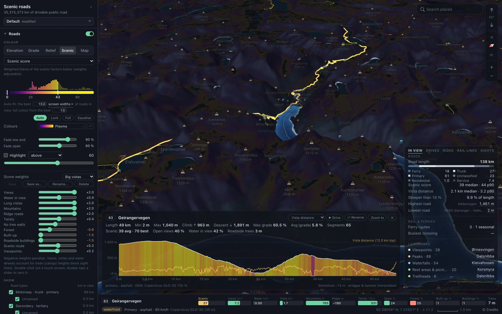

<b>A personal, offline-capable dark map for finding scenic drives and rides.</b> 
Every car-accessible public road, passenger rail line and ferry in the world, draped on 3D terrain on a globe 
and coloured by elevation, grade or one of a dozen scenic metrics computed from 15 km viewsheds.

  <a href="#what-it-shows">What it shows</a> ·
  <a href="#layers">Layers</a> ·
  <a href="#tools">Tools</a> ·
  <a href="#a-world-tour">World tour</a> ·
  <a href="#using-it">Using it</a> ·
  <a href="#how-the-scenic-metrics-are-computed">Metrics</a> ·
  <a href="#building-and-running">Building</a> ·
  <a href="#data">Data</a>

---

- **Roads** coloured by elevation, grade, relief, a street map's look, or scenic metrics whose
  viewsheds see over terrain and **tree canopy heights**.
- **Passenger rail** scored for the view from the carriage window, or coloured by official line
  colour, service or trains a day; **ferries** by sailings a day or season.
- **Landmarks** (peaks, waterfalls, lighthouses, viewpoints, heritage sites, parks…) sized by
  prominence, with details from official registers and Wikidata.
- **3D terrain** with hill-shading, elevation or slope tint and contour lines; **3D buildings**,
  **tree cover**, **depth** under the seas and lakes, and coastal shading.
- The coverage is the whole Earth (`inputs/regions/`, `cover = "earth"`); the build is still filling
  it in, one z6 tile at a time.

## What it shows

The **Colour** row at the top of the settings panel picks what the roads show. Each colour scale has a
histogram of what's in view, auto-fit (by screen widths of road or by percentiles), Lock / Full /
Equalise, a colour map, a low-end fade and a threshold highlight.

| Mode | Shows |
|---|---|
| **Elevation**, **Grade**, **Relief** | Height, steepness over ~50 m, local relief (lowest to highest road in view). |
| **Scenic score** | A weighted blend of 12 factors (below); presets in `web/src/data/weight-presets.json`, editable in the app. |
| Views, Water views, Vista distance | Area and water area visible within 15 km; mean farthest visible distance. |
| Terrain drama, Ridge ↔ valley | Relief within 3 km; height above or below the terrain within 1.5 km. |
| Curviness | Turning in °/km. |
| Unblocked views | Share of directions not walled in within 300 m. |
| Roadside trees, Forest cover, Open land, Built-up | Tree height and cover, fields, built-up land nearby. |
| Roadside buildings | Share of the frontage lined with buildings within 30–80 m. |
| **Map** | A street map's look, set by presets (classic atlases, dark-map palettes, an attribute: speed, lanes, surface, one-way & toll) and then edited: colour by, per road class fill colour and opacity, casing colour, cased. |

<table>
  <tr>
    <td>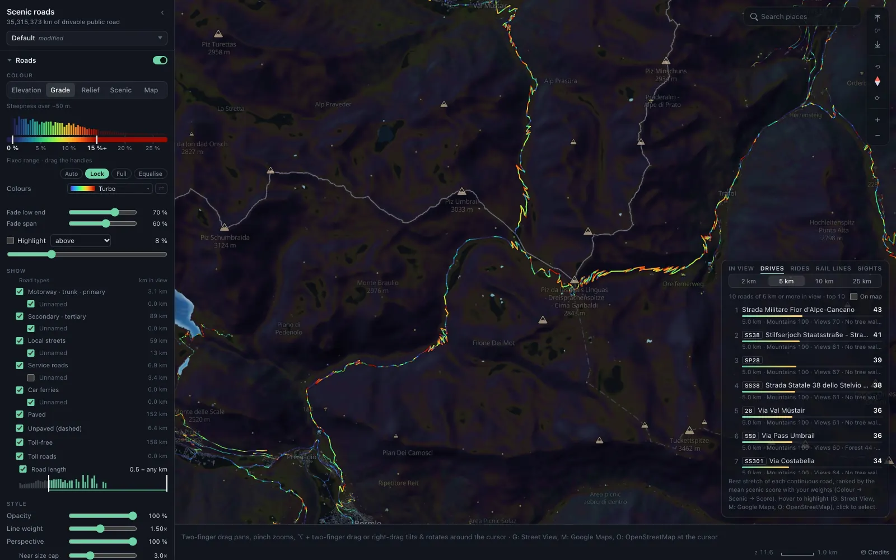</td>
    <td>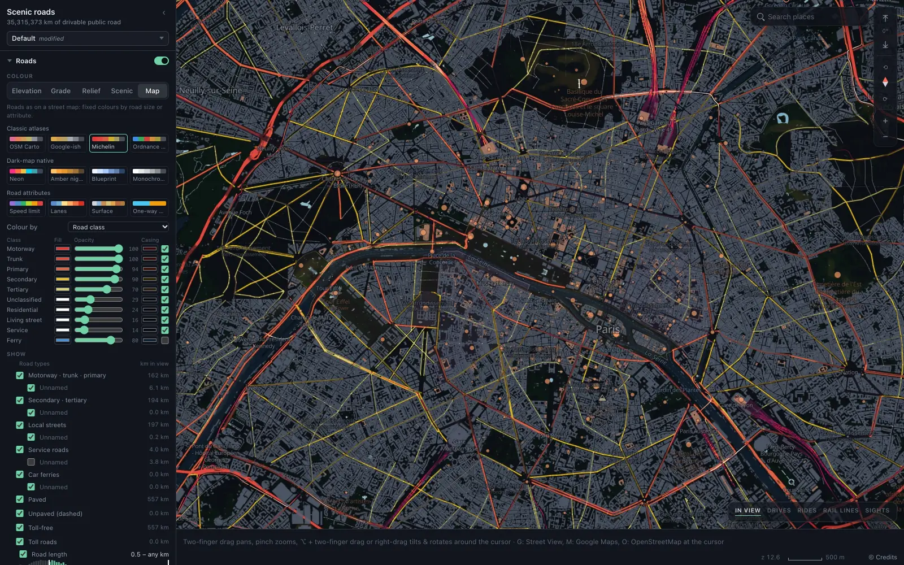</td>
  </tr>
  <tr>
    <td><b>Grade</b> around the Stelvio Pass, Turbo colours, the <b>Drives</b> list: the best 5 km stretch of each road in view by your weights.</td>
    <td><b>Map</b> mode over Paris with the <b>Michelin</b> preset; the lists folded away.</td>
  </tr>
</table>

## Layers

The settings panel has a section per layer (Roads, Passenger rail, Ferries, Stops & sights, Terrain,
Trees, Depth, Buildings, Map, Labels), then Tools and Regions.

<table>
  <tr>
    <td>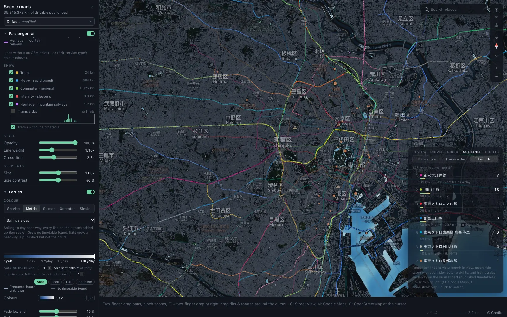</td>
    <td>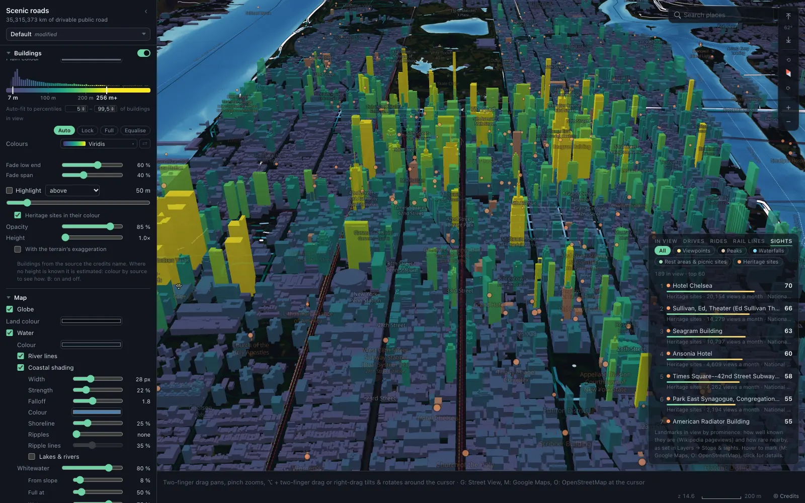</td>
  </tr>
  <tr>
    <td><b>Passenger rail</b> in Tokyo, each line in its official colour, roads dimmed; the <b>Rail lines</b> list ranks the lines in view by ride score, trains a day or length.</td>
    <td><b>3D buildings</b> in Midtown Manhattan coloured by height; the <b>Sights</b> list ranks the landmarks in view by prominence.</td>
  </tr>
  <tr>
    <td>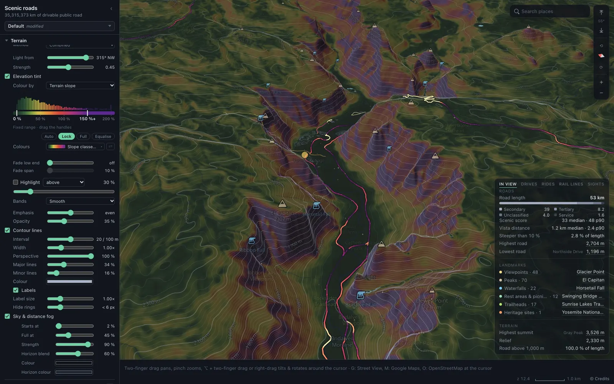</td>
    <td>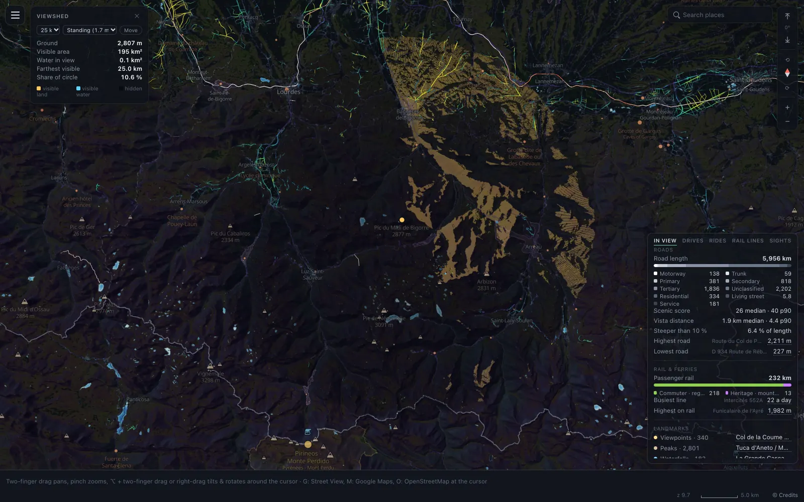</td>
  </tr>
  <tr>
    <td><b>Terrain</b> in Yosemite Valley: tinted by slope (slope classes), contour lines, tree cover off, roads by <b>Curviness</b>.</td>
    <td><b>What can I see from here?</b> (Tools) from the Pic du Midi de Bigorre: visible land and water within 25 km; roads by <b>Vista distance</b>, the settings panel folded away.</td>
  </tr>
</table>

## Tools

- **Elevation profile**: clicking a road or line opens its profile (length, climb, grade, scenic
  score, the metric of your choice along it) with **▶ Drive**, a 3D fly-along.
- **Lists** (bottom right): In view, Drives (the best 2–25 km stretch of each road in view by your
  weights), Rides, Rail lines, Sights.
- **What can I see from here?** (Tools): a 2,048-ray viewshed from any point, standing, from a
  roof or from a tower, out to 5–25 km.
- **Hover inspector** in the bottom bar: score factors as bars, tags, areas.
- **Search places**, and **© Credits** for the sources.

## A world tour

Six places, each with different settings.

<table>
  <tr>
    <td>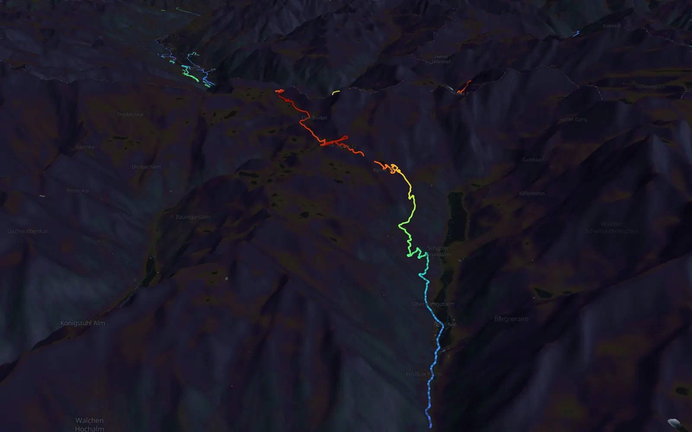</td>
    <td>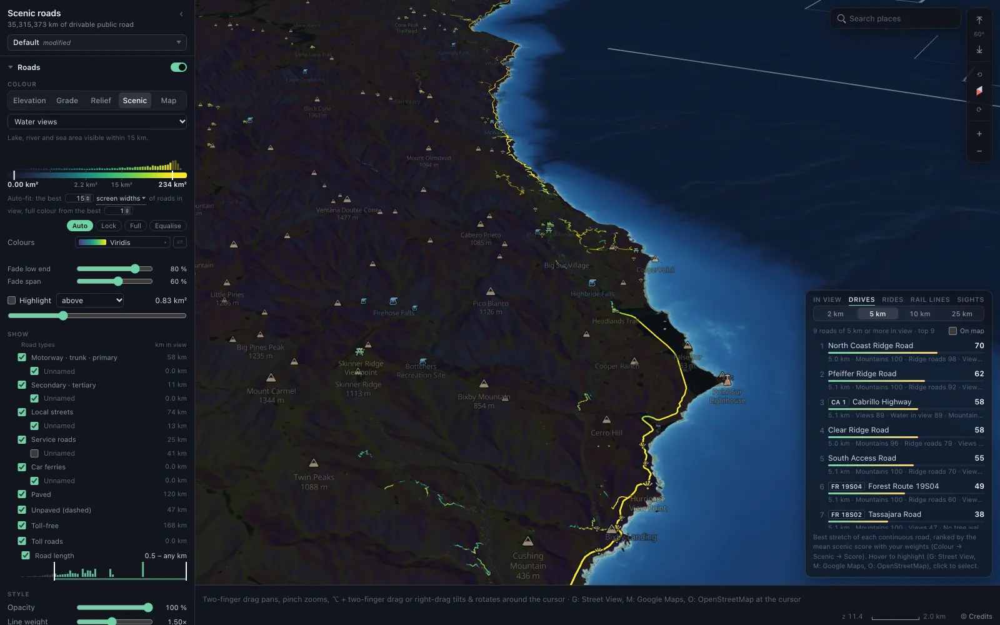</td>
  </tr>
  <tr>
    <td><b>Mountains</b>: the Grossglockner High Alpine Road, Austria. Elevation, Turbo, roads drawn heavier, the interface hidden (<b>I</b>).</td>
    <td><b>Coast</b>: Big Sur, California. Water views, Viridis, the Drives list along Highway 1.</td>
  </tr>
  <tr>
    <td>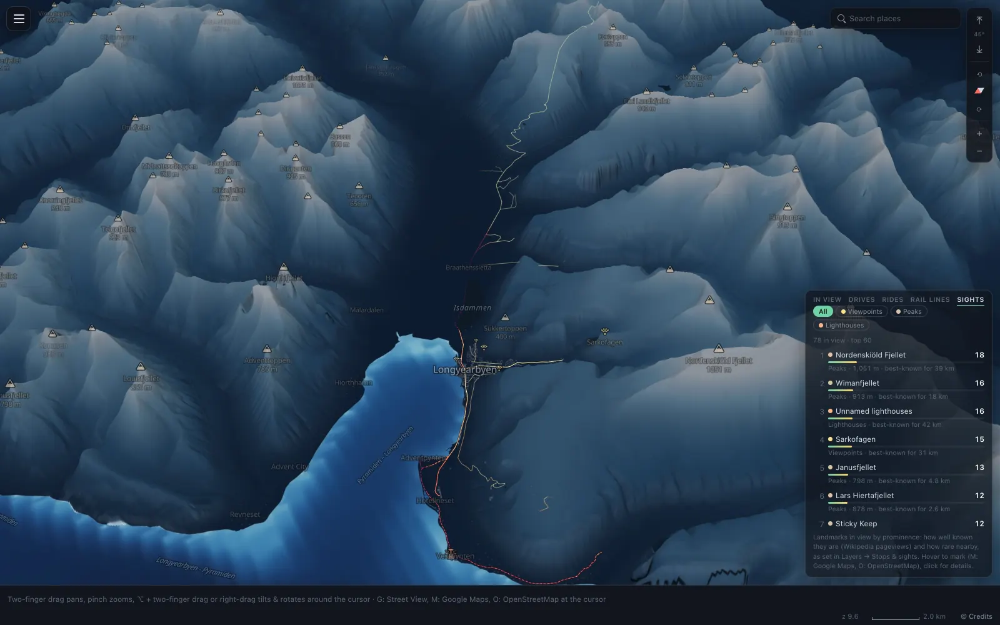</td>
    <td>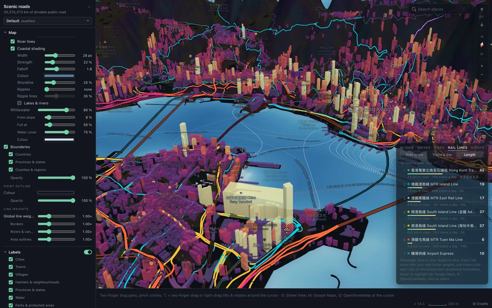</td>
  </tr>
  <tr>
    <td><b>The high Arctic</b>: Longyearbyen, Svalbard, at 78° N. Terrain drama, Magma, the terrain tinted by elevation in glacier blues, the settings panel folded, the Sights list.</td>
    <td><b>City</b>: Victoria Harbour, Hong Kong. The Map mode's <b>Neon</b> preset, 3D buildings by height in Magma, rail in line colours.</td>
  </tr>
  <tr>
    <td>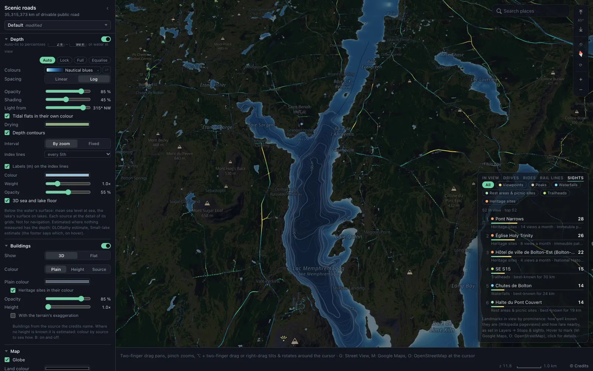</td>
    <td>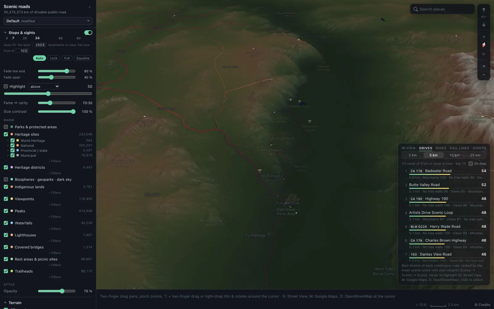</td>
  </tr>
  <tr>
    <td><b>Lake</b>: Lac Memphrémagog, Québec. Its surveyed floor (GBLQ) by depth with depth contours, roads by Unblocked views in Viridis, the Sights list.</td>
    <td><b>Desert</b>: Death Valley, California. Relief, Rocket, the terrain tinted by elevation in earth tones, tree cover off; the Stops & sights settings and the Drives list.</td>
  </tr>
</table>

## Using it

The map server runs on the Mac mini and serves the map to the other Macs, the phone and the iPad
over the tailnet (`docs/macs.md`, Devices). A laptop away from it opens its own offline map from
the menu bar (Open the map on this Mac): what was downloaded there (Settings → Regions → Downloads:
the World zoomed out, a region, or the view). The map supports Chrome and Safari.

- **Navigation:** trackpad pan and pinch anchored to the ground; ⌥ + two-finger drag (or
  right-drag, which glides on after release) rotates and tilts; double-click zooms, and double-click
  then hold and drag down or up zooms in or out about the click. Touch screens pan, pinch and
  rotate.
- **Keys:** **I** hides the interface, **B** toggles buildings, **/** searches. Over a road, list
  entry or profile: **G** Street View, **M** Google Maps, **O** OpenStreetMap.
- **Settings** persist in the browser, and the URL carries them, so a link shares the view. A
  **settings profile** (the menu atop the panel) is every setting of the panel, shared by everyone
  using the map. Defaults are `defaults` in `web/src/state.ts`; Reset to defaults is at the foot of
  the panel.

## How the scenic metrics are computed

1. **Samples** every 100 m along roads (eye 1.5 m) and rail (2.8 m); bridges use the deck, tunnels
   see nothing.
2. **Near field (0–300 m):** a horizon in 32 directions over terrain plus Meta/WRI's median canopy
   height; a direction rising more than 5° is blocked.
3. **Far field (300 m – 15 km):** rays over a ~55 m grid of terrain plus canopy, with curvature and
   refraction, starting at the near-field horizon: visible area, visible water (ESA WorldCover),
   farthest visible distance.
4. **Landscape:** relief within 3 km, topographic position within 1.5 km, open land within 1 km,
   built-up land within 500 m, roadside buildings (Overture footprints), forest cover within 150 m,
   p95 roadside tree height within 30 m.
5. **Flags:** scenic route, viewpoint within 1 km, heritage within 500 m, parks, UNESCO/dark-sky
   areas, Indigenous lands, waterfront within 100 m.
6. **Score:** each factor normalised to 0–1; score = Σ wᵢcᵢ / Σ max(wᵢ, 0), the same in the shader
   and the server.

Rail frequencies come only from published timetables (GTFS feeds from the Mobility Database and
operators, plus hand-researched files), matched onto OSM tracks (`docs/steps.md`). Ferry sailings
come from GTFS, hand-checked timetables, or OSM `interval` + `opening_hours`; never estimated.

## Building and running

The pool's lead, the Mac mini (`scenic agent`, `crates/agentcore/src/agent`), builds the map into the
NAS from a worldwide OpenStreetMap download, a z6 tile at a time, and publishes a catalogue that the
map server switches to in place. The other Macs and any browser on the LAN help through its
coordinator (`docs/coordinator.md`, `docs/pool.md`). The build runs on a Mac while Scenic
(/Applications/Scenic.app, installed by `tools/app/install.sh`) is open there.

- `scenic status` shows what the build is doing; `scenic pause` / `scenic resume` pause the whole
  build; `scenic lead` shows who leads; `scenic --help` lists the commands. The menu bar item and the
  lead's build page (at its coordinator's root, `/build/` through Caddy) show and control the same.
- **Inputs** are NAS inputs folders, each checked before use (`docs/inputs.md`): regions
  (`inputs/regions/`, §6.1), translations and descriptions (`inputs/translations/`,
  `inputs/descriptions/`; what still lacks them is listed in each `todo/`), heritage registers
  (§6.5), languages (§6.2), timetables (§6.7), elevation (§6.8), depth (§6.10).
- **Publishing the app** (`tools/app/publish.sh`) needs Rust (per `rust-toolchain.toml`), Node, pnpm
  and the wasi-sdk (per `mise.toml`, `mise install`) and `pnpm install --frozen-lockfile` in `web/`.
  The agent also needs uv, `osmium-tool`, Java 21+ and Planetiler's jar on the NAS.
- **Formatting:** run `cargo fmt` before committing (`rustfmt.toml`); `tools/app/guards.sh` fails
  publishing on `cargo fmt --check`. `.git-blame-ignore-revs` skips the one reformat commit
  (`git config blame.ignoreRevsFile .git-blame-ignore-revs`).
- **Checks:** `tools/dev/check.sh` before reporting work, the tests as `tools/dev/testing.md` says.
- **Tools:** `tools/bench/` (load and frame benchmarks), `tools/coastcheck/` (shoreline accuracy),
  `tools/devtools/` (the dev tools app: the task board and the dev job dashboard).

### Docs

| Doc | What it covers |
|---|---|
| `docs/surface.md` | What the user sees and does. |
| `docs/building.md` | Units, jobs, the scheduler and its order. |
| `docs/pipeline.md` | Every build step as one row of one table. |
| `docs/steps.md` | Each step in detail, its keys. |
| `docs/storage.md`, `docs/formats.md` | The NAS and its files. |
| `docs/macs.md`, `docs/pool.md`, `docs/coordinator.md` | Each Mac's agent, server and mirror; the pool and its lead; the coordinator and its workers. |
| `docs/regions.md`, `docs/inputs.md` | Coverage and regions; the inputs folders and their checks. |
| `docs/names.md`, `docs/sizes.md`, `docs/buildings3d.md` | Names and descriptions; sizes; 3D buildings. |
| `docs/polar.md` | The polar caps past 85° (planned: built and tested, not yet in the live build). |
| `docs/diagram/` | The pipeline diagram (`python3 page.py out.html`, then republish out.html to https://claude.ai/artifact/2LamxyqCeK6YLbkSpPPbrj). |
| `web/maplibre/FORK.md` | Our MapLibre changes. |

Phases, known gaps, risks and decisions are on the task board.

## Data

The map's **© Credits** dialog lists each source as its catalogue serves it (`CREDITS` in
`crates/inputs/src/rules.rs`, plus the inputs' own descriptions).

<b>Sources and licences</b>

| What | Source | Licence / terms |
|---|---|---|
| Roads, rail, ferries, water, boundaries, places, parks, POIs, Indigenous land boundaries | OpenStreetMap | © OpenStreetMap contributors, ODbL |
| Lakes missing from OSM in parts of Canada | Natural Resources Canada **CanVec** 1:50,000 Hydro (2018) | Contains information licensed under the Open Government Licence – Canada |
| Road & rail elevation, North America | NRCan **HRDEM**, USGS **3DEP** 10 m | OGL–Canada / public domain |
| Road & rail elevation, Japan | GSI elevation tiles (地理院タイル 標高タイル) | GSI terms of use (Public Data License 1.0): "Created by editing GSI Tiles (elevation tiles (Fundamental Geospatial Data Digital Elevation Model))" |
| Road & rail elevation elsewhere | **Copernicus DEM GLO-30**; where it has no data, Terrain Tiles (Terrarium) on AWS Open Data | produced using Copernicus WorldDEM-30 © DLR e.V. 2010–2014 and © Airbus Defence and Space GmbH 2014–2018 provided under COPERNICUS by the European Union and ESA; Mapzen / various open sources |
| 3D terrain, hill-shading, contours, analysis grid | The roads' elevation datasets, the same at every point: regional where declared, else Copernicus DEM GLO-30, else Terrain Tiles (Terrarium) on AWS Open Data | Mapzen / various open sources; produced using Copernicus WorldDEM-30 © DLR e.V. 2010–2014 and © Airbus Defence and Space GmbH 2014–2018 provided under COPERNICUS by the European Union and ESA |
| Depth of the seas | GEBCO_2026 Grid; EMODnet Bathymetry (Europe); NOAA BlueTopo and the NCEI Coastal Relief Model (US coasts); CHS NONNA (Canada) | Each source's terms (in © Credits) |
| Depth of lakes | NOAA NCEI Great Lakes bathymetry; Québec's GBLQ (surveyed lakes); elsewhere estimated: GLOBathy on HydroLAKES v1.0 (10 ha and more), smaller lakes from the land's slope around them | GLOBathy CC0; HydroLAKES CC BY 4.0; each other source's terms |
| Tree canopy height & cover | Meta & WRI global canopy height | CC BY 4.0 |
| Forest leaf type, Europe | Copernicus HRL Dominant Leaf Type 2018 | Copernicus free and open data policy |
| Forest leaf type, North America | NALCMS 2020 Land Cover of North America (CEC; NRCan/CCRS, USGS, INEGI, CONAFOR) | CEC terms of use (attribution) |
| Land cover | ESA WorldCover 2021 10 m | CC BY 4.0 |
| Buildings (roadside and 3D) | Overture Maps buildings (© OpenStreetMap contributors, Microsoft, Esri Community Maps, USGS, IGN España, Google and others) | ODbL 1.0 · CDLA Permissive 2.0 |
| 3D building heights in high-rise cores | GHSL GHS-BUILT-H R2023A (EC JRC), © European Union, 1995-2026 | CC BY 4.0 |
| Rail and ferry frequency | Operators' GTFS timetables (Mobility Database catalogue; SNCF, Renfe; Rail Delivery Group via Catenary Transit; Hong Kong Transport Department; Singapore LTA DataMall); the MTR's lines researched on mtr.com.hk | Each operator's open-data terms; Singapore Open Data Licence 1.0 |
| UNESCO World Heritage | UNESCO open data `whc001` | © UNESCO World Heritage Centre, CC BY-SA 4.0 |
| Canadian federal designations | Parks Canada Directory of Federal Heritage Designations | OGL–Canada |
| US designations | NPS National Register of Historic Places | Public domain |
| Québec | MCC Répertoire du patrimoine culturel | CC BY 4.0 |
| Ontario | Ontario Heritage Act Register (Ontario Heritage Trust) | Personal non-commercial use only |
| Nova Scotia | Registered Heritage Properties; Halifax municipal heritage properties | NS Open Government Licence; HRM open data |
| Other Canadian provinces and territories | Canadian Register of Historic Places; Moncton open data | Non-commercial reproduction with credit |
| Biosphere reserves, geoparks, dark-sky places | UNESCO MAB & Global Geoparks, DarkSky International, RASC | Facts from the official registries |
| France | Ministère de la Culture, base Mérimée; Géoportail de l'Urbanisme | Licence Ouverte 2.0 |
| Andorra | Govern d'Andorra, Inventari general del patrimoni cultural | Private, personal use only |
| England · Scotland · Wales · Northern Ireland | Historic England NHLE; Historic Environment Scotland; Cadw via DataMapWales; DfC Historic Environment Division | OGL v3 (attribution in © Credits) |
| Guernsey | States of Guernsey protected buildings and monuments | gov.gg terms (research and private use) |
| Ireland | NIAH; Sites and Monuments Record | CC BY 4.0 |
| Spain | Regional registers of bienes de interés cultural; Andalucía's IAPH | Per region: CC BY / CC BY-SA / free use with credit |
| Portugal | Património Cultural, I.P., Atlas do Património Classificado | CC BY-NC 4.0 |
| Hong Kong | Antiquities and Monuments Office via the CSDI Portal | DATA.GOV.HK terms (credit the CSDI Portal) |
| Japan | Agency for Cultural Affairs, 国指定文化財等データベース; MLIT 国土数値情報 A43 | PDL 1.0 ("edited" credit); A43 CC BY 4.0 |
| Taiwan | Bureau of Cultural Heritage open data | Open Government Data License 1.0 |
| Singapore | data.gov.sg: NHB, URA | Singapore Open Data Licence 1.0 |
| Facts about POIs, heritage sites and parks | Wikidata, via QLever (University of Freiburg) | CC0 |
| Heritage descriptions | English Wikipedia short descriptions; descriptions written by Claude from Wikipedia articles or register entries | CC BY-SA 4.0 (sources credited) |
| Peak prominence & isolation | Computed from the terrain; OSM and Wikidata values preferred | Derived |

**Terrain.** The 3D terrain is sampled from the same elevation datasets as the roads, in the same
order, so a road and the ground under it always come from one dataset: regional lidar and DEMs where
declared, then Copernicus GLO-30 (its filled voids left out), then AWS's Terrain Tiles. Coarser
zooms are the means of the finer tiles under them. It keeps the sources' heights at sea, over lakes
and below 0 m, their artefacts included; only where no dataset has data is it sea level
(`terrain_base`, `docs/steps.md`).

> [!IMPORTANT]
> Portugal's atlas is non-commercial (CC BY-NC); the Ontario Heritage Trust register, Andorra's
> inventory and Guernsey's data are for personal or private use. **Do not publish or redistribute
> the built data or a hosted copy of this map.**

## Known limitations

- The analysis grid is ~55 m, so narrow gorges and summit domes are smoothed; a viewshed from a
  rounded summit at 1.5 m (2.8 m by rail) is pessimistic.
- Canopy heights are 2019–2020 medians over ~28 m cells.
- Bridge decks are interpolated between abutments; grade reflects DEM and OSM accuracy.
- Most lakes' depths are estimates (GLOBathy's, or from the slope around a small lake), not surveys.
- A passenger line with no OSM route relation (and not a tram, metro, funicular or heritage line by
  its tags) is missing.
- The lowest heritage grades (England Grade II and the like, ~450,000 buildings) are left out;
  Spain's national register, Monaco, the Isle of Man, Jersey and Gibraltar have no usable register.
- Past 85° N and S the map has no tiles yet (the polar caps: `docs/polar.md`, planned).
